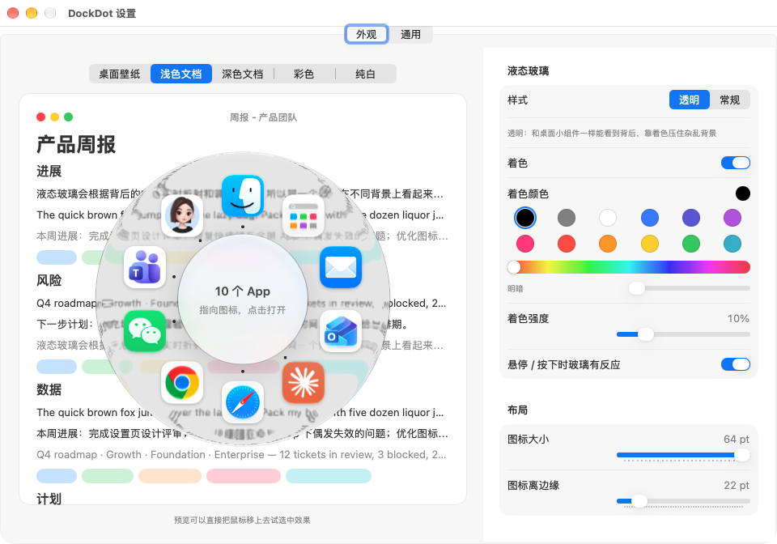

# DockDot

简体中文 | [English](README_EN.md)

**把 Mac 的 Dock 收进一个小圆点。**

DockDot 在屏幕边缘放一个类似 iPhone「辅助触控」的半透明小圆点。点一下，或者在任何地方单按一下 **⌥⌘**，就会弹出一个液态玻璃圆盘，你 Dock 上的 App 均匀排成一圈。指向某个方向、点一下就打开。把系统 Dock 设成自动隐藏之后，屏幕上就几乎看不到 Dock 了。



## 功能

- **悬浮小圆点**：可以拖到任意位置，松手会吸附到最近的屏幕边缘，并记住位置。不用的时候半透明，鼠标移上去变清楚。
- **⌥⌘ 快捷键**：单独按一下 ⌥⌘ 就会在鼠标位置打开面板，再按一下收起。按住 ⌥⌘ 时按了别的键或点了鼠标（比如 ⌥⌘D、⌥⌘Esc、⌥⌘ 拖动），不会误触发。
- **环形面板**
  - 内容和 Dock 保持同步：先是 Dock 上固定的 App，后面接着正在运行但没固定的 App，所有图标等间距排成一圈。
  - 鼠标从圆心往哪个方向移就选中哪个图标，不用精确放在图标上。选中的光晕会在图标之间滑动。
  - 圆心显示 App 名称和状态（运行中 / 未运行 / 未固定在 Dock）。
  - 正在运行的 App，图标旁有一个小点。
  - 也可以用键盘：← → 切换，回车打开，Esc 关闭。
- **原生液态玻璃**：外圈用系统的透明液态玻璃（`NSGlassEffectView`），和桌面小组件是同一种材质；圆心是一小块常规玻璃，文字背景再乱也看得清。
- **跨屏幕、跨桌面切换**：App 的窗口如果在另一块屏幕上一个没显示的桌面（Space）里，点它会直接切到那个桌面，和点 Dock 图标的效果一样。
- **设置窗口**：外观参数都能调，左边有实时预览，并提供五种参考背景（桌面壁纸、浅色文档、深色文档、彩色、纯白），方便检查玻璃在各种背景上的效果。
- **中英文界面**：在 设置 → 通用 → 界面语言 里切换「跟随系统 / 简体中文 / English」，立即生效。

## 系统要求

- **macOS 26（Tahoe）或更高版本**：液态玻璃是 macOS 26 才有的系统功能。在 macOS 27.2 上开发和测试。
- Apple 芯片和 Intel 的 Mac 都可以用（安装包是通用版）
- 「悬停 / 按下时玻璃有反应」需要 macOS 27

DockDot 启动时会先检查环境。如果系统低于 macOS 26，会弹出提示说明原因，提供「打开软件更新」按钮，然后退出，不会打开一个用不了的 App。

## 安装

### 下载安装（推荐）

1. 到 [Releases](https://github.com/mars7233/DockDot/releases/latest) 下载 `DockDot-x.y.z.dmg`，双击打开。
2. 把 **DockDot** 拖到旁边的 **Applications（应用程序）** 文件夹。
3. 在「应用程序」里打开 DockDot。

如果直接在安装盘里双击打开，DockDot 会提示你先把它放进「应用程序」文件夹，也可以点按钮让它自己移过去并重新打开。原因是：从安装盘里运行时，macOS 会把 App 放在一个临时位置，辅助功能权限和开机启动都会失效。

**第一次打开被拦住？** DockDot 没有付费的 Apple 开发者签名，所以 macOS 第一次会提示「无法验证开发者」或「Apple 无法检查其是否包含恶意软件」。处理方法：打开 **系统设置 → 隐私与安全性**，在页面下方找到 DockDot，点「**仍要打开**」。只需要这一次。

### 授权系统权限

DockDot 需要两项系统权限（都在 **系统设置 → 隐私与安全性** 里）：

- **输入监控**：识别单按一下 ⌥⌘。
- **辅助功能**：点图标时把其他屏幕、其他桌面上的窗口带到前面。

授权步骤：

1. 打开 **系统设置 → 隐私与安全性**，分别进入 **辅助功能** 和 **输入监控**。
2. 打开 DockDot 的开关；如果列表里没有，点「+」，选择「应用程序」里的 DockDot。
3. 从菜单栏退出 DockDot，再重新打开。

没有授权时，小圆点照样能用，但 ⌥⌘ 快捷键和跨桌面切换可能不起作用。**设置 → 权限** 里逐项列出了每个权限的用途和当前状态，并提供对应的按钮。

> 开关明明打开了、DockDot 却仍显示未授权？这通常是因为那条授权属于签名不同的旧版本。在 **设置 → 权限** 里点「重新授权」，按系统提示重新打开开关即可。

### 推荐：把系统 Dock 设成自动隐藏

```bash
defaults write com.apple.dock autohide -bool true && killall Dock
```

### 从源码编译

需要 Xcode 或 Command Line Tools（Swift 6）。

```bash
git clone git@github.com:mars7233/DockDot.git
cd DockDot
./scripts/make-signing-cert.sh   # 只需运行一次：创建本机自用的签名证书
./build.sh                       # 编译本机架构、签名，安装到 ~/Applications/DockDot.app
open ~/Applications/DockDot.app
```

打发布用的安装包（Apple 芯片 + Intel 通用版，输出到 `dist/DockDot-<版本>.dmg`）：

```bash
VERSION=1.0.0 ./scripts/package-dmg.sh
```

**为什么要建签名证书？** macOS 是按 App 的签名来记住「辅助功能」权限的。不用固定的证书签名的话，每次重新编译签名都会变，系统会把它当成一个新 App，你就得重新授权一次。`make-signing-cert.sh` 会在「登录」钥匙串里建一个只在本机使用的自签名证书「DockDot Local Signing」，打包脚本找到它就会用它签名。钥匙串里显示它「不受信任」是正常的，不影响使用。不建这个证书也能编译，只是会退回临时签名，每次编译后都要重新授权。发布版也用这个证书签名，所以用户升级到新版本时不用重新授权。

> 打包脚本会先在临时目录里组装和签名。这是因为开了 iCloud 同步的「文稿」等目录会给文件加扩展属性，`codesign` 遇到这些属性会拒绝签名。

## 使用

| 操作 | 效果 |
|---|---|
| 点击小圆点 | 在小圆点旁边打开 / 收起面板 |
| 拖动小圆点 | 换位置，松手后吸附到最近的屏幕边缘 |
| 单按一下 ⌥⌘ | 在鼠标位置打开 / 收起面板 |
| 鼠标往某个方向移 | 选中那个方向的图标 |
| 点击 / 回车 | 打开选中的 App |
| ← → | 用键盘切换选中的图标 |
| Esc、点圆心、点面板外面 | 收起面板 |

菜单栏的 ◎ 图标里有：打开面板、显示/隐藏小圆点、设置…（⌘,）、退出。

## 设置

**外观**：每一项改动都会立刻反映在左边的预览里，下次打开面板时生效。

| 分组 | 参数 |
|---|---|
| 液态玻璃 | 样式（程序坞 / 透明 / 常规）、着色开关、着色颜色（内置调色盘）、着色强度、悬停 / 按下时玻璃有反应 |
| 布局 | 排列方式（自动 / 一圈 / 蜂窝）：一圈是图标沿圆排一圈；蜂窝像 Apple Watch 的应用页，图标排成六边形网格、越往外越小，App 多时更紧凑；自动模式下 App 超过设定数量（默认 14）就改用蜂窝。一圈的样式（圆环 / 圆盘）：圆环只在图标那一圈放玻璃、中间留空。另有图标大小（36–64 pt）、图标离边缘的距离 |
| 细节 | 圆心玻璃（让中间文字更清楚）、选中光晕强度、运行中的小点 |

默认值：程序坞样式（和系统 Dock 同一种材质）、不着色，图标 64 pt，离边缘 22 pt，选中光晕 21%。随时可以点「恢复默认外观」。

**通用**：界面语言、显示小圆点、小圆点不用时的透明度、快捷键说明、开机自动启动。

**权限**：逐项列出 DockDot 需要的权限（辅助功能、输入监控、登录项）、是否必需、用途和当前状态（自动刷新），以及不使用的权限和隐私说明。如果系统设置里开关已打开、这里却显示未授权，说明那条授权属于签名不同的旧版本，点「重新授权」即可。

**关于**：版本号、版权和许可证，以及到 GitHub 项目主页和反馈问题的链接。

所有设置都存在 `~/Library/Preferences/local.dockdot.plist`。

## 实现原理

| 部分 | 做法 |
|---|---|
| 读取 Dock 内容 | 读系统 Dock 配置 `com.apple.dock` 里的 `persistent-apps` 得到固定的 App，再从 `NSWorkspace.runningApplications` 补上正在运行但没固定的 App |
| 打开 App | `NSWorkspace.openApplication`，效果和点 Dock 图标一样：没运行就启动，运行中就切过去，最小化的窗口也会恢复 |
| ⌥⌘ 单按检测 | 全局监听 `flagsChanged`。只有「从 ⌥⌘ 的子集按进来、再松开，期间没有别的按键或鼠标点击、且 0.8 秒内松开」才算一次单按。是否有别的输入，同时用两种方式判断：按键/点击监听，以及系统全局输入计数器（`CGEventSource.counterForEventType`） |
| 液态玻璃 | 默认的「程序坞」样式用的是系统 Dock 自己的材质：`NSGlassEffectView` 的私有档位 `_variant = 3`；面板窗口对 `_hasActiveAppearance` 等私有方法返回真，并调用 `_windowChangedKeyState`，让玻璃始终按「激活」状态渲染（否则是乳白的非激活材质）；再把玻璃滤镜的内折射改成 Dock 的值（高度 13.28、强度 −29.88）。把它和真实 Dock 放在同一块背景上逐像素对比：壁纸和彩色背景上亮度差不到 1（0–255），文字背景上约 10；公开的「常规」样式在壁纸上要亮约 93。做法参考 [tungsten-edge](https://github.com/moonbai-studio/tungsten-edge) 和 [Dockline](https://github.com/HuanCheng65/Dockline)。圆心是另一块玻璃，文字放在它的 `contentView` 里，系统会按背景明暗自动选深色或浅色字 |
| 跨桌面切换 | 辅助功能接口只能看到当前正在显示的桌面上的窗口。如果 App 在这些桌面上没有正常的文档窗口（画中画、置顶小窗这类悬浮窗口不算），就从 `CGWindowListCopyWindowInfo`（覆盖所有桌面）里找到它最前面、且确实在某个桌面上的窗口（普通窗口和「置顶」窗口都算），用 SkyLight 的 `_SLPSSetFrontProcessWithOptions` / `SLPSPostEventRecordTo` 把它放到最前，再通过远程令牌拿到这个窗口的辅助功能元素执行「提到最前」（参考 [AltTab](https://github.com/lwouis/alt-tab-macos)）。有些 App（比如 PiliPlus 的置顶播放窗口）不支持这一步，系统就不会切桌面；这时 DockDot 会算出目标桌面在那块屏幕上的位置，临时把鼠标移过去，用系统的「向左 / 向右移动一个桌面」快捷键（Ctrl+← / Ctrl+→）切过去，再把鼠标移回来 |

### 代码结构

```
Sources/DockDot/
├── main.swift            入口：先做环境检测，再启动；调试参数
├── EnvironmentCheck.swift 启动前的环境检测（系统版本、是否从安装盘运行）
├── AppDelegate.swift     组装各部分、菜单栏菜单
├── Dot.swift             悬浮小圆点（拖动、吸附、记住位置）
├── Hotkey.swift          ⌥⌘ 单按检测
├── Launcher.swift        面板窗口、定位、打开 / 收起
├── RadialView.swift      环形布局、液态玻璃、选中、鼠标 / 键盘交互
├── DockReader.swift      读取 Dock 内容、打开 App
├── SpaceFocus.swift      切到其他桌面上的窗口
├── Settings.swift        设置数据（UserDefaults）
├── SettingsWindow.swift  设置窗口（SwiftUI，左侧导航）：外观、通用、权限、关于
└── Lang.swift            中英文切换
Resources/AppIcon.icns        App 图标（由 scripts/make-icon.swift 生成）
scripts/make-signing-cert.sh  创建本机自用签名证书
scripts/make-app.sh           编译、组装、签名 DockDot.app
scripts/package-dmg.sh        打包发布用的 DMG（通用版）
build.sh                      本地开发：编译并安装到 ~/Applications
```

### 调试参数

```bash
# 打印读到的 Dock 内容
~/Applications/DockDot.app/Contents/MacOS/DockDot --dump

# 打印点击每个运行中的 App 会怎么切换（不会真的切换），排查多屏 / 多桌面问题
~/Applications/DockDot.app/Contents/MacOS/DockDot --where

# 启动时直接打开设置窗口（可指定标签页：appearance / general / permissions / about）
open ~/Applications/DockDot.app --args --settings
open ~/Applications/DockDot.app --args --settings-tab about

# 打印环境检测结果；后两个参数在正常的 Mac 上模拟「系统太旧」「从安装盘运行」的提示
~/Applications/DockDot.app/Contents/MacOS/DockDot --env-check

# 在 App 自己的进程里检查辅助功能权限，结果写进文件
open ~/Applications/DockDot.app --args --ax-report /tmp/dockdot-ax.txt

# 走和点图标完全一样的流程打开某个 App，并把切换桌面的每一步写进日志（会真的切换）
open ~/Applications/DockDot.app --args --open-app pili /tmp/dockdot-open.log
open ~/Applications/DockDot.app --args --simulate-old-macos
open ~/Applications/DockDot.app --args --simulate-dmg
```

## 已知限制

- 跨桌面切换用到了 SkyLight 私有接口，以后的 macOS 更新可能会让它失效。失效时会退回普通的「激活 App」，不会崩溃。
- 面板只显示 App，不显示 Dock 上的文件夹、文件和废纸篓。
- App 超过 22 个时会自动排成内外两圈。
- 没有 Apple 开发者签名和公证，第一次打开需要在「隐私与安全性」里点「仍要打开」。
- 只在 Apple 芯片的 Mac、macOS 27.2 上测试过；Intel 版能编译，但没有在真机上跑过。

## 致谢

- [chillintheshade/dok](https://github.com/chillintheshade/dok)：液态玻璃轮盘的材质用法（原生玻璃、不裁剪、圆心镜片）参考了它。
- [lwouis/alt-tab-macos](https://github.com/lwouis/alt-tab-macos)：跨桌面聚焦窗口的做法。
- [ricky-yosh/RadialMenu](https://github.com/ricky-yosh/RadialMenu)：⌥⌘ 快捷键的灵感来源。

## 许可证

DockDot 采用 [PolyForm Strict 1.0.0](LICENSE) 许可证，版权归 Mason 所有。

- ✅ 可以：个人或非营利目的下载、安装、使用 DockDot，阅读源码
- ❌ 不可以：用于商业目的；修改代码或基于它做新作品；复制、转发、重新分发代码或安装包
- 引用、复制、商业使用或其他许可之外的用途，请先通过 [GitHub](https://github.com/mars7233) 联系作者获得书面许可
