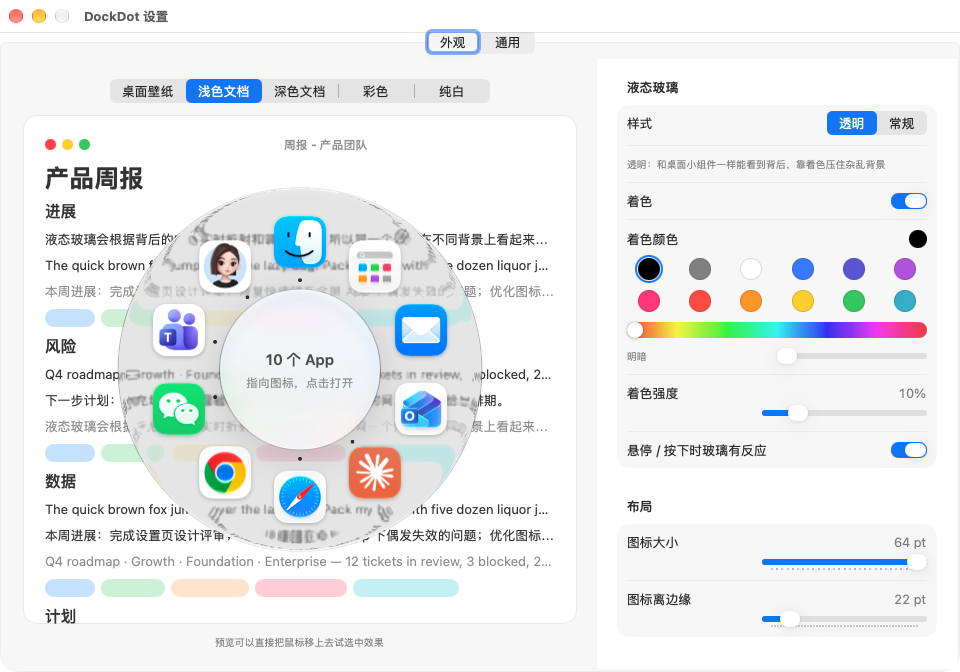

# DockDot

[简体中文](README.md) | English

**Your Mac's Dock, tucked into a small dot.**

DockDot puts a translucent dot at the edge of your screen, much like iPhone's AssistiveTouch. Click it, or tap **⌥⌘** anywhere, and a Liquid Glass disc pops up with your Dock's apps arranged evenly in a circle. Point in a direction and click to open. With the system Dock set to auto-hide, the Dock practically disappears from your screen.



## Features

- **Floating dot**: drag it anywhere; it snaps to the nearest screen edge and remembers its position. Translucent when idle, fully visible on hover.
- **⌥⌘ shortcut**: tap ⌥⌘ on its own to open the panel at the pointer, tap again to close it. Holding ⌥⌘ while pressing another key or clicking (⌥⌘D, ⌥⌘Esc, ⌥⌘-drag…) never triggers it.
- **Radial panel**
  - Mirrors your Dock: pinned apps first, then running apps that aren't pinned, all evenly spaced around the circle.
  - Move the pointer from the center toward an icon to select it — no need to land exactly on it. The selection glow glides between icons.
  - The center shows the app name and its state (Running / Not running / Not in Dock).
  - Running apps have a small indicator next to their icon.
  - Keyboard works too: ← → to select, Return to open, Esc to close.
- **Native Liquid Glass**: the ring uses the system's clear Liquid Glass (`NSGlassEffectView`), the same material as desktop widgets; the center is a small piece of regular glass so its label stays readable over any background.
- **Switches displays and Spaces**: if an app's window lives on a Space that isn't showing (e.g. another Space on your second display), clicking it switches straight to that Space — just like clicking its Dock icon.
- **Settings window**: every appearance option is adjustable, with a live preview over five reference backgrounds (wallpaper, light document, dark document, colorful, white).
- **English and Chinese UI**: switch under Settings → General → Interface language (Follow System / 简体中文 / English); takes effect immediately.

## Requirements

- **macOS 26 (Tahoe) or later** — Liquid Glass is a system feature introduced in macOS 26. Developed and tested on macOS 27.2.
- Apple silicon and Intel Macs (the download is a universal build)
- "Glass reacts to hover / press" needs macOS 27

DockDot checks its environment at launch. On anything older than macOS 26 it explains why it can't run, offers to open Software Update, and quits — instead of opening an app that doesn't work.

## Installation

### Download (recommended)

1. Download `DockDot-x.y.z.dmg` from [Releases](https://github.com/mars7233/DockDot/releases/latest) and open it.
2. Drag **DockDot** onto the **Applications** folder next to it.
3. Open DockDot from Applications.

If you open DockDot directly from the disk image, it asks you to move it to Applications first, and can do it for you. When run from a disk image, macOS launches apps from a temporary location, which breaks Accessibility access and Launch at Login.

**Blocked on first launch?** DockDot isn't signed with a paid Apple Developer ID, so the first time macOS says it "can't verify the developer" or "can't check it for malicious software". To allow it: open **System Settings → Privacy & Security**, scroll down to DockDot and click **Open Anyway**. You only need to do this once.

### Grant system permissions

DockDot needs two system permissions (both under **System Settings → Privacy & Security**):

- **Input Monitoring** — recognizes a tap of ⌥⌘.
- **Accessibility** — brings windows on other displays and Spaces forward when you click an icon.

To grant them:

1. Open **System Settings → Privacy & Security**, then go to **Accessibility** and **Input Monitoring**.
2. Turn on DockDot in each. If it isn't listed, click "+" and choose DockDot in Applications.
3. Quit DockDot from the menu bar and open it again.

Without them, the floating dot still works, but the ⌥⌘ shortcut and Space switching may not work. **Settings → Permissions** lists each permission with what it's for, its current status, and a button to fix it.

> Switch is on but DockDot still says not granted? That entry usually belongs to an older build with a different signature. Click **Re-authorize** under **Settings → Permissions** and turn the switch on again when prompted.

### Recommended: auto-hide the system Dock

```bash
defaults write com.apple.dock autohide -bool true && killall Dock
```

### Build from source

Requires Xcode or the Command Line Tools (Swift 6).

```bash
git clone git@github.com:mars7233/DockDot.git
cd DockDot
./scripts/make-signing-cert.sh   # once: creates a local code-signing certificate
./build.sh                       # builds for this Mac, signs, installs to ~/Applications/DockDot.app
open ~/Applications/DockDot.app
```

Build the release disk image (universal Apple silicon + Intel, written to `dist/DockDot-<version>.dmg`):

```bash
VERSION=1.0.0 ./scripts/package-dmg.sh
```

**Why a signing certificate?** macOS remembers Accessibility access by the app's code signature. Without a stable certificate, every build gets a new signature, macOS treats it as a different app, and you have to grant access again. `make-signing-cert.sh` creates a self-signed certificate, "DockDot Local Signing", in your login keychain for use on this Mac only; the build scripts sign with it when present. Keychain Access showing it as "not trusted" is normal and doesn't matter. Without it, builds fall back to ad-hoc signing and need re-granting after every build. Release builds are signed with this certificate too, so upgrading to a new version keeps your Accessibility access.

> The scripts assemble and sign the app in a temporary folder, because iCloud-synced folders such as Documents add extended attributes that make `codesign` refuse to sign.

## Usage

| Action | Result |
|---|---|
| Click the dot | Open / close the panel next to the dot |
| Drag the dot | Move it; it snaps to the nearest screen edge |
| Tap ⌥⌘ | Open / close the panel at the pointer |
| Move the pointer toward an icon | Select it |
| Click / Return | Open the selected app |
| ← → | Select with the keyboard |
| Esc, click the center, click outside | Close the panel |

The ◎ menu bar icon has: Open Panel, Show/Hide Dot, Settings… (⌘,), Quit.

## Settings

**Appearance** — every change shows up in the live preview right away and applies the next time the panel opens.

| Group | Options |
|---|---|
| Layout | Arrangement (Automatic / Single ring / Honeycomb): a single ring of icons, or a honeycomb like the Apple Watch app grid — a hexagonal grid with smaller icons toward the edge, more compact with many apps; Automatic switches to honeycomb above a set number of apps (14 by default). Ring style (Ring / Disc), icon size (36–64 pt), distance from the glass edge |
| Outer Glass | Style (Dock / Clear / Regular; Dock is a fixed style identical to the system Dock, without tint), tint on/off / color (built-in palette) / strength, feedback on hover and press, distortion (5% by default, matching the system Dock) |
| Center Glass | Single-ring arrangement only: show or hide, its own style, tint, distortion (50% by default), edge feather (15% by default, fades out the outer band so no edge line shows) |
| Icons & Selection | Selection glow strength, running indicators |

Defaults: Dock style (the system Dock's own material), 64 pt icons, 22 pt from the edge, 21% selection glow. "Restore Default Appearance" brings them back.

**General** — interface language, show the floating dot, its idle opacity, shortcut notes, launch at login.

**Permissions** — lists each permission DockDot uses (Accessibility, Input Monitoring, Login Items), whether it's required, what it's for and its current status (refreshes automatically), plus permissions it doesn't use and privacy notes. If a switch is on in System Settings but this page says not granted, that entry belongs to an older build with a different signature — click Re-authorize.

**About** — version, copyright and license, with links to the GitHub project and issue tracker.

All settings are stored in `~/Library/Preferences/local.dockdot.plist`.

## How it works

| Part | Approach |
|---|---|
| Reading the Dock | Pinned apps come from `persistent-apps` in the system Dock's `com.apple.dock` preferences; running apps that aren't pinned come from `NSWorkspace.runningApplications` |
| Opening apps | `NSWorkspace.openApplication`, which behaves like clicking a Dock icon: launches the app if needed, otherwise switches to it and restores minimized windows |
| Detecting the ⌥⌘ tap | A global `flagsChanged` monitor. It only counts as a tap if ⌥⌘ is entered from a subset of itself and released within 0.8 s with no other key or click in between. Other input is detected two ways: key/click monitors and the system-wide input counter (`CGEventSource.counterForEventType`) |
| Liquid Glass | The default Dock style uses the system Dock's own material: `NSGlassEffectView`'s private `_variant = 3`. The panel window answers the private `_hasActiveAppearance` family with true and calls `_windowChangedKeyState`, so the glass always renders in its active state (otherwise it is the milky inactive material), and the glass filter's inner refraction is set to the Dock's values (height 13.28, amount −29.88). Compared pixel by pixel with the real Dock over the same background, brightness differs by under 1 (0–255) over wallpaper and colorful backgrounds and about 10 over text; the public Regular style is about 93 brighter over wallpaper. Based on [tungsten-edge](https://github.com/moonbai-studio/tungsten-edge) and [Dockline](https://github.com/HuanCheng65/Dockline). The center is a separate glass whose `contentView` holds the labels, so the system picks dark or light text |
| Switching Spaces | The Accessibility API only sees windows on Spaces that are currently showing. If an app has no regular document window there (floating windows such as picture-in-picture or pinned mini players don't count), DockDot finds its frontmost window that actually belongs to a Space — regular or stay-on-top — in `CGWindowListCopyWindowInfo` (which covers every Space), brings it forward with SkyLight's `_SLPSSetFrontProcessWithOptions` / `SLPSPostEventRecordTo`, then gets that window's accessibility element through a remote token and raises it (as [AltTab](https://github.com/lwouis/alt-tab-macos) does). Some apps (e.g. PiliPlus's pinned player) don't support raising, so macOS doesn't switch Spaces; DockDot then works out where the target Space sits on that display, briefly moves the pointer there, presses the system's "Move left / right a space" shortcut (Ctrl+← / Ctrl+→) the right number of times, and moves the pointer back |

### Project layout

```
Sources/DockDot/
├── main.swift             Entry point: environment check, then launch; debug flags
├── EnvironmentCheck.swift Startup checks (macOS version, running from the disk image)
├── AppDelegate.swift      Wires everything together; menu bar menu
├── Dot.swift              Floating dot (drag, snap, remembered position)
├── Hotkey.swift           ⌥⌘ tap detection
├── Launcher.swift         Panel window, positioning, open / close
├── RadialView.swift       Ring layout, Liquid Glass, selection, mouse / keyboard
├── DockReader.swift       Reading the Dock, opening apps
├── SpaceFocus.swift       Bringing forward windows on other Spaces
├── Settings.swift         Settings model (UserDefaults)
├── SettingsWindow.swift   Settings window (SwiftUI, sidebar): Appearance, General, Permissions, About
└── Lang.swift             English / Chinese switching
Resources/AppIcon.icns        App icon (generated by scripts/make-icon.swift)
scripts/make-signing-cert.sh  Create the local signing certificate
scripts/make-app.sh           Build, assemble and sign DockDot.app
scripts/package-dmg.sh        Build the release DMG (universal)
build.sh                      Local development: build and install to ~/Applications
```

### Debug flags

```bash
# Print what DockDot reads from the Dock
~/Applications/DockDot.app/Contents/MacOS/DockDot --dump

# Print how clicking each running app would switch (without switching) — for multi-display / Spaces issues
~/Applications/DockDot.app/Contents/MacOS/DockDot --where

# Open the Settings window at launch (optionally a tab: appearance / general / permissions / about)
open ~/Applications/DockDot.app --args --settings
open ~/Applications/DockDot.app --args --settings-tab about

# Print the environment check result; the other two simulate the "macOS too old" and "running from the disk image" prompts
~/Applications/DockDot.app/Contents/MacOS/DockDot --env-check

# Check Accessibility access from inside the app's own process; writes the result to a file
open ~/Applications/DockDot.app --args --ax-report /tmp/dockdot-ax.txt

# Open an app through exactly the same path as clicking its icon, logging each Space-switching step (really switches)
open ~/Applications/DockDot.app --args --open-app pili /tmp/dockdot-open.log
open ~/Applications/DockDot.app --args --simulate-old-macos
open ~/Applications/DockDot.app --args --simulate-dmg
```

## Known limitations

- Switching Spaces uses a private SkyLight API that a future macOS update may break. DockDot then falls back to a normal app activation instead of crashing.
- The panel shows apps only — not the Dock's folders, files or Trash.
- With more than 22 apps, icons are arranged in an inner and an outer ring.
- Without an Apple Developer ID signature and notarization, the first launch needs "Open Anyway" in Privacy & Security.
- Tested only on Apple silicon with macOS 27.2; the Intel build compiles but hasn't been run on real hardware.

## Thanks

- [chillintheshade/dok](https://github.com/chillintheshade/dok) — how to use native glass for a radial wheel (native glass, no clipping, center lens).
- [lwouis/alt-tab-macos](https://github.com/lwouis/alt-tab-macos) — focusing windows across Spaces.
- [ricky-yosh/RadialMenu](https://github.com/ricky-yosh/RadialMenu) — inspiration for the ⌥⌘ shortcut.

## License

DockDot is licensed under [PolyForm Strict 1.0.0](LICENSE). Copyright © 2026 Mason.

- ✅ Allowed: downloading, installing and using DockDot for personal or noncommercial purposes; reading the source
- ❌ Not allowed: commercial use; modifying the code or creating new works based on it; copying or redistributing the code or the app
- For quoting, copying, commercial use or anything else beyond this license, please contact the author via [GitHub](https://github.com/mars7233) for written permission first.
